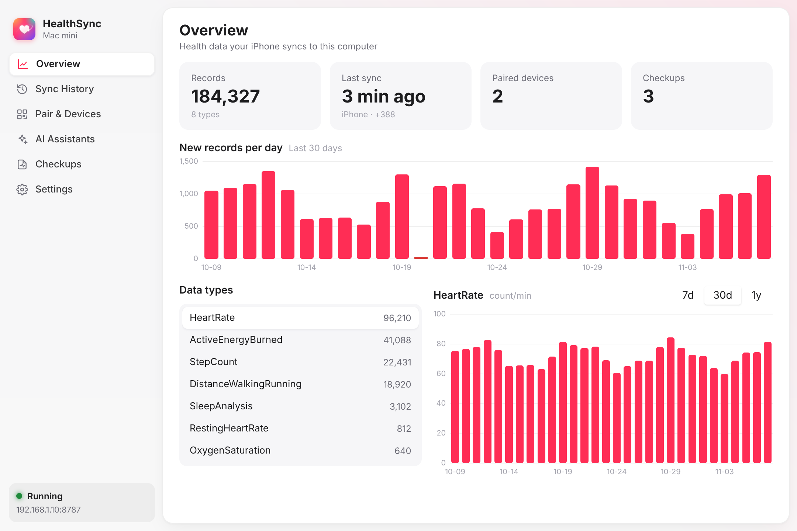
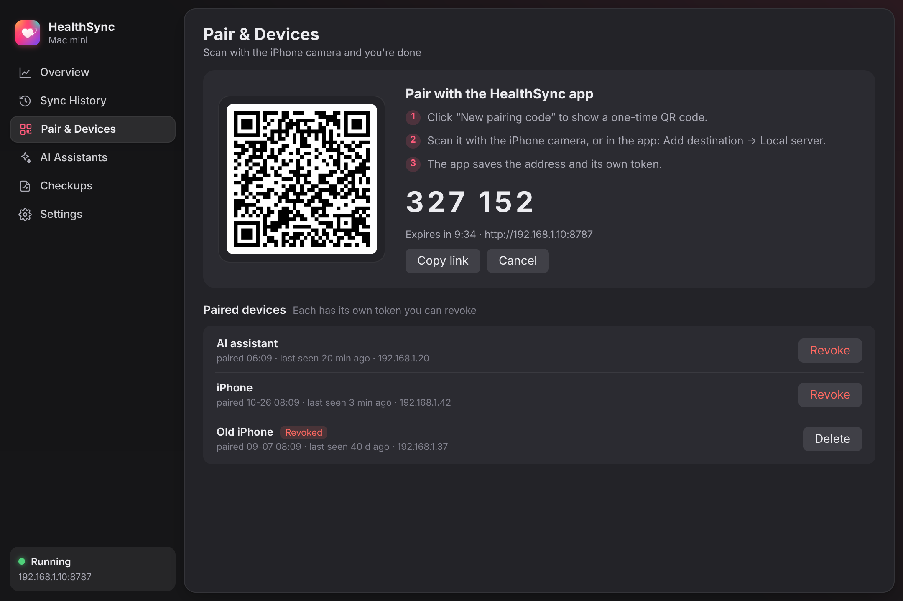
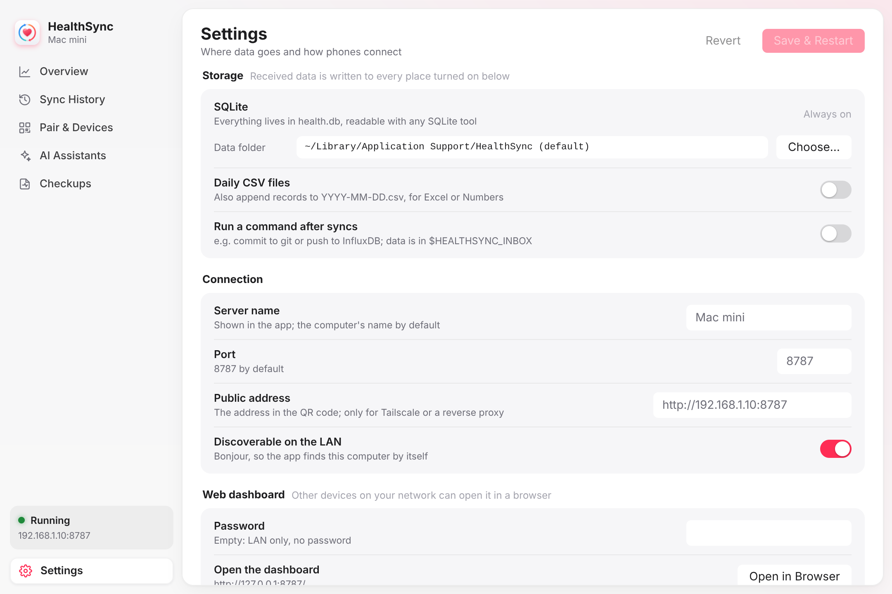

# healthsync-server

English | [简体中文](README.zh-CN.md)

healthsync-server receives Apple Health data from the **HealthSync** iPhone app. It keeps
the data in a SQLite database on your computer. It is one binary file or one Docker image.
It does not use a cloud service. It does not need an account.

## Features

- **Dashboard.** The dashboard shows:
  - The number of records for each day.
  - A daily chart for each data type.
  - The sync history: the device, the number of records, the new records, the failures and
    the rejected tokens.
  - The checkup reports.

  The desktop app shows the dashboard in its window. The headless server shows it in a web
  browser.
- **Pairing with a QR code.** Click **Pair a new iPhone**. Scan the QR code with the iPhone
  camera. Each paired device gets its own token. You can revoke a token in the dashboard.
- **Discovery.** The server announces `_healthsync._tcp` with Bonjour (mDNS). The app finds
  the server on your Wi-Fi network. You do not type an address.
- **Plain SQLite data.** The data is in the `records` table and the `daily` view. You can read
  it with `sqlite3`, Datasette, Grafana, pandas or other tools. The server can also write one
  CSV file for each day. It can also run your command after each sync, for example to commit
  to git or to send data to InfluxDB.
- **MCP for AI assistants.** An AI assistant can read your data with read-only tools. Example
  question: "How did my resting heart rate change this month?" Use HTTP (`/mcp`) or stdio
  (`healthsync-server mcp`).
- **Platforms.** macOS, Linux (x86 and ARM, Raspberry Pi, NAS), Windows and FreeBSD.

## Two ways to run the server

- **HealthSync, the desktop app** (macOS, Windows, Linux). The app has a menu bar icon and a
  native window. [MyGo](https://github.com/egoist/mygo) draws the window on the GPU. The app
  does not use a webview or Electron. Use the app to:
  - Pair an iPhone with a QR code.
  - See the syncs.
  - Connect AI assistants.
  - Select where the data goes: a folder, daily CSV files, and a command to run after syncs.

  The app keeps its settings in `settings.json` in the user configuration folder.
- **healthsync-server, headless** (servers, NAS, Raspberry Pi, Docker). This is the same
  server with a web dashboard. The desktop binary also runs in this mode with `--headless`.



| Pairing | Settings |
|---|---|
|  |  |

## Desktop app

### Install the app

1. Go to [Releases](../../releases).
2. Download the file for your system: `.dmg` (macOS), `-setup.exe` (Windows), or `.deb` or
   `.tar.gz` (Linux).
3. Install the app.
4. On macOS, open the app the first time with right-click › **Open**. The macOS build is not
   notarized yet.

### Build the app from source

```sh
make run          # Build to dist/dev/HealthSync and run it.
make preview      # Show the window with sample data in a browser (WebAssembly).
make app          # Make the packaged apps in build/.
```

### Stop the app

When you close the window, the server continues to run in the menu bar. To stop the server,
click the menu bar icon and select **Quit**.

## Headless server

### Run the binary

1. Go to [Releases](../../releases).
2. Download the archive for your system.
3. Extract the archive.
4. Start the server:

   ```sh
   ./healthsync-server            # The server starts on port 8787.
   ```

5. Open `http://<this-computer>:8787/` in a browser.
6. Go to **Pair & devices**.
7. Click **Pair a new iPhone**.
8. Scan the QR code with the iPhone.

To show the pairing code and the QR code in the terminal, run `./healthsync-server pair`.

To keep the server running after a restart, use one of these files:

- Linux (systemd): `contrib/healthsync.service`
- macOS (launchd): `contrib/com.healthsync.server.plist`

### Run with Docker

```sh
docker run -d --name healthsync --restart unless-stopped \
  --network host -v "$PWD/data:/data" ghcr.io/herosizy/healthsync-server
```

You can also use the [docker-compose.yml](docker-compose.yml) file:

```sh
docker compose up -d
```

The server keeps its data in `/data` in the container. The `-v` option connects `/data` to a
folder on your computer (`./data` in the example). Your data stays in that folder when you
remove or update the container.

Use `--network host`. With host networking, the app can discover the server, and the QR code
contains the correct LAN address.

Docker Desktop (Mac and Windows) does not have host networking. On Docker Desktop:

1. Publish the port with `-p 8787:8787`.
2. Set `HEALTHSYNC_PUBLIC_URL=http://<your-LAN-IP>:8787`.
3. Pair with the QR code.

### Build from source

```sh
go install github.com/herosizy/healthsync-server@latest
```

The code is pure Go and does not use cgo. To build for a different system, set `GOOS` and
`GOARCH`. Example: `GOOS=linux GOARCH=arm64 go build`.

## Configuration

Each flag has an environment variable.

| Flag | Environment variable | Default | Description |
|---|---|---|---|
| `-port` | `HEALTHSYNC_PORT` | `8787` | The port. |
| `-bind` | `HEALTHSYNC_BIND` | `0.0.0.0` | The address to listen on. |
| `-data` | `HEALTHSYNC_DATA` | Refer to the next list. | The folder for `health.db`, `reports/` and `token`. |
| `-name` | `HEALTHSYNC_NAME` | The computer name | The name that the app shows. |
| `-public-url` | `HEALTHSYNC_PUBLIC_URL` | The LAN IP address | The address in the QR code. |
| `-admin-password` | `HEALTHSYNC_ADMIN_PASSWORD` | None | The dashboard password. Any user name is correct. |
| `-dashboard-lan-only` | `HEALTHSYNC_DASHBOARD_ANYWHERE=1` turns it off | On | The dashboard accepts only LAN and loopback clients. |
| `-csv` | `HEALTHSYNC_CSV` | Off | Also write `<dir>/YYYY-MM-DD.csv`. |
| `-hook` | `HEALTHSYNC_HOOK` | Off | The command to run after data arrives. |
| `-no-bonjour` | `HEALTHSYNC_NO_BONJOUR=1` | | Do not announce the server with Bonjour. |
| `-no-dialog` | `HEALTHSYNC_NO_DIALOG=1` | | macOS: do not show the "Allow?" dialog. Use codes only. |
| | `HEALTHSYNC_DASHBOARD_APPROVAL=1` | | Linux and Windows: a device can ask to pair without a code. You approve it in the dashboard. |
| | `HEALTHSYNC_TOKEN` | Generated | A fixed shared token. |

The default data folder is:

- macOS: `~/Library/Application Support/HealthSync`
- Linux: `~/.local/share/healthsync`
- Windows: `%APPDATA%\HealthSync`
- Docker: `/data`

## Security

Use the server on your home network.

- The server accepts pairing (`POST /pair`) only from private and loopback addresses.
- The dashboard also accepts only these addresses. You can turn off this limit.
- A pairing code has 6 digits. You can use it one time only. It is valid for 10 minutes.
  After 5 incorrect attempts, the code stops working.
- The server keeps only a hash of each device token.

If you use a reverse proxy to make the server available outside your LAN, do these steps:

1. Set `HEALTHSYNC_ADMIN_PASSWORD`.
2. Put TLS in front of the server.

## Tailscale

If this computer is on a tailnet, you do not have to configure the server. The server finds
its Tailscale address. It puts this address in:

- `/health` (`"urls": {"lan": …, "tailscale": …}`)
- The pairing replies
- The QR code (`alt=`)

When the iPhone is away from home, the app uses this address through the Tailscale app.

Devices on the same tailnet (100.64.0.0/10 and fd7a:115c:a1e0::/48) are on the local
network for pairing and for the dashboard.

## Updates and crash reports

### Updates

The desktop app updates itself from the releases of this repository.

- The app checks for updates one time each day.
- Each update has a signature. The MyGo updater checks the signature with the public key in
  `mygo.json`.
- To turn off automatic updates, go to **Settings › Updates**.
- To check now, go to **Settings › Updates**, or select **Check for Updates…** in the menu
  bar.

### Crash reports

Official builds send crash reports to Sentry. A report contains the error, the stack trace,
the version and the operating system. The server removes requests, health data and host names
before it sends a report.

To stop crash reports, do one of these steps:

- Turn off **Settings › Privacy › Send crash reports**.
- Set `HEALTHSYNC_NO_TELEMETRY=1`.

Builds from source do not send crash reports.

## Make a release

1. Change `version` in `mygo.json`.
2. Add a `## <version>` section to `CHANGELOG.md`.
3. Push to `main`.

The release workflow then does these steps:

1. It adds the tag `v<version>`.
2. It builds the server binaries, the Docker image, and the desktop apps with their signed
   updates.
3. It puts all the files in a draft release.
4. It publishes the release when all the files are there.

The workflow needs the `MYGO_UPDATER_PRIVATE_KEY` secret. To make the key, run
`go tool mygo keygen`.

## Hook

Use `-hook 'my-script.sh'` to run a command after each sync. The server does these steps:

1. It writes the received records to `<data>/inbox/app-*.txt` in the pipe format (refer to
   [API](#api)).
2. It waits until the sync has no new data for 20 seconds.
3. It runs the command one time.

The command gets these environment variables:

| Variable | Value |
|---|---|
| `HEALTHSYNC_EVENT` | `ingest` or `report`. |
| `HEALTHSYNC_INBOX` | The inbox folder. Your script must move or delete the files that it processed. |
| `HEALTHSYNC_REPORT_DIR` | The folder of the checkup report that the server received. |
| `HEALTHSYNC_DATA`, `HEALTHSYNC_DB` | The data folder and the database path. |

The sync history in the dashboard shows the output and the exit status of the command.

## AI assistants (MCP)

The server supports the [Model Context Protocol](https://modelcontextprotocol.io). All tools
are read-only:

- `list_data_types`
- `daily_summary`
- `get_records`
- `get_checkups`
- `query_sql` (one SELECT statement on a read-only connection)

### Connect over the network

The network connection uses Streamable HTTP.

1. In the dashboard, go to **Pair & devices › AI assistants**.
2. Click **Create token**.
3. Copy the command that the dashboard shows. Example for Claude Code:

   ```sh
   claude mcp add --transport http healthsync http://192.168.1.10:8787/mcp \
     --header "Authorization: Bearer <token>"
   ```

### Connect on the same computer

The stdio connection reads `health.db` directly. It does not need a token.

```json
{ "mcpServers": { "healthsync": { "command": "/usr/local/bin/healthsync-server", "args": ["mcp"] } } }
```

**Caution:** The AI assistant sends the data that it reads to its model provider.

## Database

```sql
-- All samples. The server removes duplicates by uuid, or by (type, start, end, source, value).
SELECT * FROM records WHERE type = 'HKQuantityTypeIdentifierStepCount' ORDER BY start DESC LIMIT 10;
-- Totals for each day.
SELECT day, total FROM daily WHERE type = 'HKQuantityTypeIdentifierStepCount' ORDER BY day DESC;
-- Checkup values from the app.
SELECT date, name, value, unit, flag FROM checkup ORDER BY date DESC;
```

The database also has these tables:

- `sync_log`: the sync history in the dashboard.
- `devices`: the paired devices.
- `reports`: the checkup reports.

## API

The app uses these endpoints. Other clients can use them too.

| Endpoint | Description |
|---|---|
| `GET /health` | Returns `{"ok":true,"name":…,"version":2,"records":2,"os":…,"pair_modes":[…],"mcp":"/mcp","urls":{…}}`. `"records": 2` means that `/ingest` keeps the full JSON Lines records and accepts deletions. Refer to [Full records](#full-records). |
| `POST /pair` | Send `{"device":"…","code":"123456"}`. Returns `{"token":…}`. Without a code, the server returns `428` and `needs_code`, or it waits for approval (macOS dialog or dashboard). |
| `POST /ingest` | Send `Authorization: Bearer <token>`. The body is one of: one record on each line as `type\|start\|end\|value\|unit\|source`; a JSON array; `{"records":[…],"deleted":["uuid",…]}`; JSON Lines; CSV or TSV with a header. Returns `{"ok":true,"received":n,"added":{…},"deleted":n}`. |
| `POST /report` | Send `{"report":{"id","date","institution","items":[{name,key,value,unit,range,flag}]},"folder":…,"files":[{"name","data"(base64)}]}`. |
| `GET /stats` | Returns the number of records for each type. |
| `POST /mcp` | MCP (Streamable HTTP, JSON responses). Send a Bearer token. |
| `POST /mcp/tokens` | Send a Bearer device token and `{"name":"Claude"}`. Returns a new token for an AI agent and configurations to copy: `{"url","token","transport","configs":{"claude_code","json","stdio_bridge","agent_prompt"},"config_list":[{"id","title","text"}]}`. You can revoke the token. |

A QR code contains `healthsync://pair?url=<server>&code=<code>&name=<name>`. If the server
has a Tailscale address, the QR code also contains `alt=<address>`.

### Full records

A JSON row can contain these fields: `uuid`, `source_bundle`, `source_version`,
`device_model`, `device_software`, `user_entered`, `tz` and `metadata` (an object of
strings). The JSON Lines export of the app contains these fields. The server keeps each
field in the column with the same name in `records`.

- The server keeps each sample one time for each `uuid`.
- A row from the pipe format has no `uuid`. When the same sample arrives again with a
  `uuid`, the server adds the `uuid` and the other fields to that row.

To delete a sample, send this line:

```json
{"uuid":"…","deleted":true}
```

You can also add `"deleted_at":"<ISO 8601>"`. The server keeps the row and sets
`deleted_at`. These items then ignore the row:

- The statistics.
- The `daily` view.
- The `v_*` views (`v_heart_rate`, `v_steps`, `v_sleep`, `v_workouts` and others). These
  views have the same names as in the D1 and Supabase schema of the app.
- MCP.

The daily CSV files and the hook inbox keep the six pipe columns. They do not get
deletions.

## License

MIT
