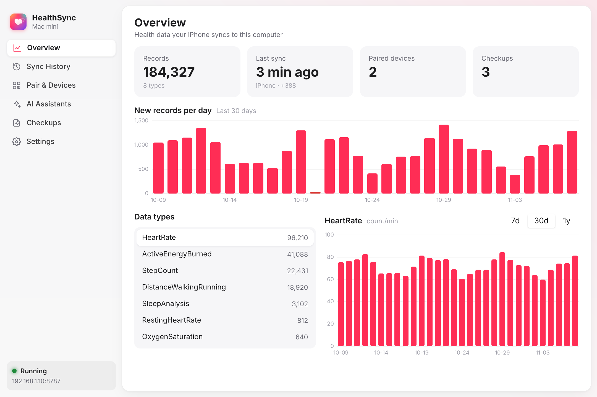
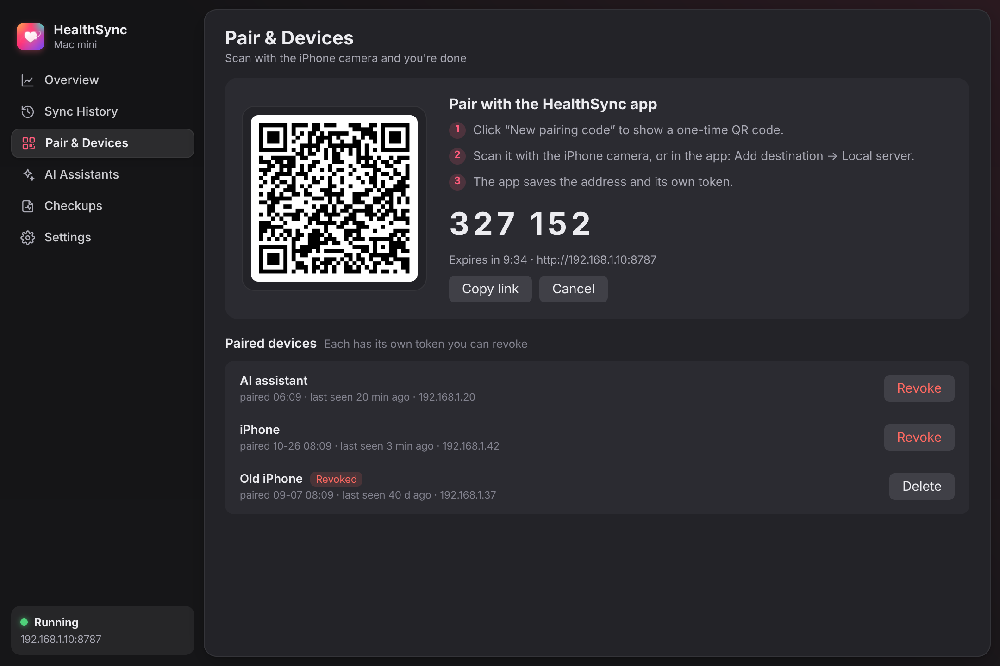
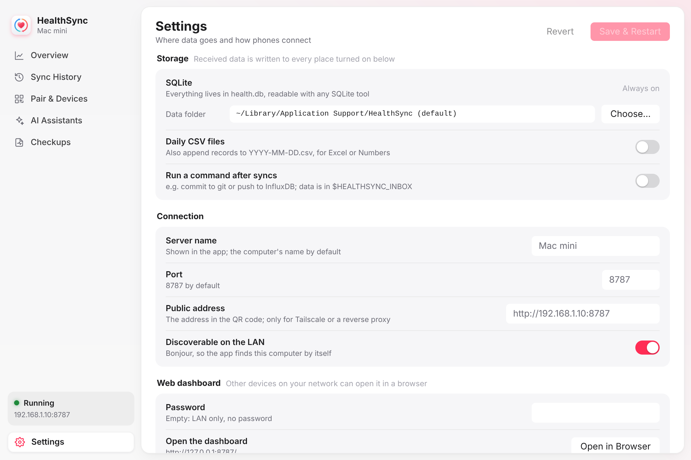

# healthsync-server

[English](README.md) | 简体中文

healthsync-server 接收 **HealthSync** iPhone App 发来的 Apple 健康数据。它把数据存在你电脑上的
SQLite 数据库里。它是一个二进制文件，或一个 Docker 镜像。它不使用云服务。它不需要账号。

## 功能

- **控制面板。** 控制面板显示：
  - 每天的记录数。
  - 每种数据类型的每日图表。
  - 同步记录：设备、记录数、新增记录数、失败次数、被拒绝的令牌。
  - 体检报告。

  桌面 App 在窗口里显示控制面板。无界面服务器在浏览器里显示控制面板。
- **扫码配对。** 点击 **配对新的 iPhone**。用 iPhone 相机扫二维码。每台配对的设备有自己的令牌。
  你可以在控制面板里撤销令牌。
- **自动发现。** 服务器用 Bonjour（mDNS）广播 `_healthsync._tcp`。App 在你的 Wi-Fi 网络里找到
  服务器。你不用输入地址。
- **普通 SQLite 数据。** 数据在 `records` 表和 `daily` 视图里。你可以用 `sqlite3`、Datasette、
  Grafana、pandas 或其它工具读取。服务器也可以每天写一个 CSV 文件。服务器也可以在每次同步后运行
  你的命令，例如提交到 git，或把数据发到 InfluxDB。
- **AI 助手的 MCP。** AI 助手可以用只读工具读取你的数据。示例问题：“我这个月的静息心率有什么变化？”
  使用 HTTP（`/mcp`）或 stdio（`healthsync-server mcp`）。
- **平台。** macOS、Linux（x86 和 ARM、树莓派、NAS）、Windows、FreeBSD。

## 两种运行方式

- **HealthSync 桌面 App**（macOS、Windows、Linux）。App 有菜单栏图标和原生窗口。
  [MyGo](https://github.com/egoist/mygo) 用 GPU 绘制窗口。App 不使用网页视图，也不使用 Electron。
  用 App 来：
  - 扫码配对 iPhone。
  - 查看同步。
  - 连接 AI 助手。
  - 选择数据存到哪里：一个文件夹、每天的 CSV 文件、同步后运行的命令。

  App 把设置存在用户配置文件夹的 `settings.json` 里。
- **healthsync-server 无界面版**（服务器、NAS、树莓派、Docker）。这是同一个服务器，带网页控制面板。
  桌面版的二进制文件加 `--headless` 也用这种方式运行。



| 配对 | 设置 |
|---|---|
|  |  |

## 桌面 App

### 安装 App

1. 打开 [Releases](../../releases)。
2. 下载适合你系统的文件：`.dmg`（macOS）、`-setup.exe`（Windows）、`.deb` 或 `.tar.gz`（Linux）。
3. 安装 App。
4. 在 macOS 上，第一次打开时右键点击 App，选择 **打开**。macOS 版本还没有经过公证。

### 从源码构建 App

```sh
make run          # 构建到 dist/dev/HealthSync 并运行。
make preview      # 在浏览器里用示例数据显示窗口（WebAssembly）。
make app          # 在 build/ 里生成安装包。
```

### 退出 App

关闭窗口后，服务器继续在菜单栏里运行。要停止服务器，点击菜单栏图标，选择 **退出**。

## 无界面服务器

### 运行二进制文件

1. 打开 [Releases](../../releases)。
2. 下载适合你系统的压缩包。
3. 解压。
4. 启动服务器：

   ```sh
   ./healthsync-server            # 服务器在 8787 端口启动。
   ```

5. 在浏览器里打开 `http://<这台电脑>:8787/`。
6. 进入 **配对与设备**。
7. 点击 **配对新的 iPhone**。
8. 用 iPhone 扫二维码。

要在终端里显示配对码和二维码，运行 `./healthsync-server pair`。

要在电脑重启后保持服务器运行，使用下面的一个文件：

- Linux（systemd）：`contrib/healthsync.service`
- macOS（launchd）：`contrib/com.healthsync.server.plist`

### 用 Docker 运行

```sh
docker run -d --name healthsync --restart unless-stopped \
  --network host -v "$PWD/data:/data" ghcr.io/herosizy/healthsync-server
```

你也可以用 [docker-compose.yml](docker-compose.yml) 文件：

```sh
docker compose up -d
```

服务器把数据存在容器里的 `/data`。`-v` 选项把 `/data` 连接到你电脑上的一个文件夹（示例里是
`./data`）。删除或更新容器后，你的数据仍然在这个文件夹里。

使用 `--network host`。使用主机网络时，App 能发现服务器，二维码里也是正确的局域网地址。

Docker Desktop（Mac 和 Windows）没有主机网络。在 Docker Desktop 上：

1. 用 `-p 8787:8787` 发布端口。
2. 设置 `HEALTHSYNC_PUBLIC_URL=http://<你的局域网 IP>:8787`。
3. 扫码配对。

### 从源码构建

```sh
go install github.com/herosizy/healthsync-server@latest
```

代码是纯 Go，不使用 cgo。要为其它系统构建，设置 `GOOS` 和 `GOARCH`。示例：
`GOOS=linux GOARCH=arm64 go build`。

## 配置

每个参数都有对应的环境变量。

| 参数 | 环境变量 | 默认值 | 说明 |
|---|---|---|---|
| `-port` | `HEALTHSYNC_PORT` | `8787` | 端口。 |
| `-bind` | `HEALTHSYNC_BIND` | `0.0.0.0` | 监听的地址。 |
| `-data` | `HEALTHSYNC_DATA` | 见下面的列表。 | 存放 `health.db`、`reports/` 和 `token` 的文件夹。 |
| `-name` | `HEALTHSYNC_NAME` | 电脑名 | App 里显示的名字。 |
| `-public-url` | `HEALTHSYNC_PUBLIC_URL` | 局域网 IP 地址 | 二维码里的地址。 |
| `-admin-password` | `HEALTHSYNC_ADMIN_PASSWORD` | 无 | 控制面板的密码。用户名可以是任意值。 |
| `-dashboard-lan-only` | `HEALTHSYNC_DASHBOARD_ANYWHERE=1` 关闭它 | 开 | 控制面板只接受局域网和本机的访问。 |
| `-csv` | `HEALTHSYNC_CSV` | 关 | 另外写入 `<dir>/YYYY-MM-DD.csv`。 |
| `-hook` | `HEALTHSYNC_HOOK` | 关 | 数据到达后运行的命令。 |
| `-no-bonjour` | `HEALTHSYNC_NO_BONJOUR=1` | | 不用 Bonjour 广播服务器。 |
| `-no-dialog` | `HEALTHSYNC_NO_DIALOG=1` | | macOS：不显示“允许？”对话框。只用配对码。 |
| | `HEALTHSYNC_DASHBOARD_APPROVAL=1` | | Linux 和 Windows：设备可以不用配对码请求配对。你在控制面板里批准。 |
| | `HEALTHSYNC_TOKEN` | 自动生成 | 固定的共享令牌。 |

默认数据文件夹：

- macOS：`~/Library/Application Support/HealthSync`
- Linux：`~/.local/share/healthsync`
- Windows：`%APPDATA%\HealthSync`
- Docker：`/data`

## 安全

在你的家庭网络里使用服务器。

- 服务器只接受来自私有地址和本机地址的配对（`POST /pair`）。
- 控制面板也只接受这些地址。你可以关闭这个限制。
- 配对码有 6 位数字。每个配对码只能用一次。配对码 10 分钟内有效。错 5 次后，配对码失效。
- 服务器只保存每个设备令牌的哈希值。

如果你用反向代理让局域网外也能访问服务器，做下面的步骤：

1. 设置 `HEALTHSYNC_ADMIN_PASSWORD`。
2. 在服务器前面加 TLS。

## Tailscale

如果这台电脑在 tailnet 里，你不用配置服务器。服务器会找到自己的 Tailscale 地址，并把这个地址放进：

- `/health`（`"urls": {"lan": …, "tailscale": …}`）
- 配对回复
- 二维码（`alt=`）

iPhone 不在家时，App 通过 Tailscale App 使用这个地址。

同一个 tailnet 里的设备（100.64.0.0/10 和 fd7a:115c:a1e0::/48）在配对和控制面板中算作局域网。

## 更新和崩溃报告

### 更新

桌面 App 从这个仓库的 Releases 自动更新。

- App 每天检查一次更新。
- 每个更新都有签名。MyGo 更新器用 `mygo.json` 里的公钥检查签名。
- 要关闭自动更新，进入 **设置 › 更新**。
- 要立即检查，进入 **设置 › 更新**，或在菜单栏选择 **检查更新…**。

### 崩溃报告

官方构建会把崩溃报告发到 Sentry。报告包含错误、调用栈、版本号和操作系统。发送前，服务器会删除
请求、健康数据和主机名。

要停止崩溃报告，做下面的一步：

- 关闭 **设置 › 隐私 › 发送崩溃报告**。
- 设置 `HEALTHSYNC_NO_TELEMETRY=1`。

从源码构建的版本不发送崩溃报告。

## 发布新版本

1. 修改 `mygo.json` 里的 `version`。
2. 在 `CHANGELOG.md` 里加一节 `## <version>`。
3. 推送到 `main`。

然后发布工作流做下面的步骤：

1. 加标签 `v<version>`。
2. 构建服务器二进制文件、Docker 镜像，以及带签名更新的桌面 App。
3. 把所有文件放进一个草稿 Release。
4. 所有文件都到齐后，发布这个 Release。

工作流需要 `MYGO_UPDATER_PRIVATE_KEY` secret。要生成密钥，运行 `go tool mygo keygen`。

## 同步后运行的命令（Hook）

用 `-hook 'my-script.sh'` 在每次同步后运行一个命令。服务器做下面的步骤：

1. 把收到的记录用竖线格式写到 `<data>/inbox/app-*.txt`（见 [API](#api)）。
2. 等到同步 20 秒没有新数据。
3. 运行一次命令。

命令会得到下面的环境变量：

| 变量 | 值 |
|---|---|
| `HEALTHSYNC_EVENT` | `ingest` 或 `report`。 |
| `HEALTHSYNC_INBOX` | 收件文件夹。你的脚本必须移走或删除处理完的文件。 |
| `HEALTHSYNC_REPORT_DIR` | 服务器刚收到的体检报告所在的文件夹。 |
| `HEALTHSYNC_DATA`、`HEALTHSYNC_DB` | 数据文件夹和数据库路径。 |

控制面板的同步记录显示命令的输出和退出状态。

## AI 助手（MCP）

服务器支持 [Model Context Protocol](https://modelcontextprotocol.io)。所有工具都是只读的：

- `list_data_types`
- `daily_summary`
- `get_records`
- `get_checkups`
- `query_sql`（在只读连接上执行一条 SELECT 语句）

### 通过网络连接

网络连接使用 Streamable HTTP。

1. 在控制面板里，进入 **配对与设备 › AI 助手**。
2. 点击 **创建令牌**。
3. 复制控制面板显示的命令。Claude Code 的示例：

   ```sh
   claude mcp add --transport http healthsync http://192.168.1.10:8787/mcp \
     --header "Authorization: Bearer <token>"
   ```

### 在同一台电脑上连接

stdio 连接直接读取 `health.db`。它不需要令牌。

```json
{ "mcpServers": { "healthsync": { "command": "/usr/local/bin/healthsync-server", "args": ["mcp"] } } }
```

**注意：** AI 助手会把它读到的数据发给它的模型提供商。

## 数据库

```sql
-- 所有样本。服务器按 uuid 或 (type, start, end, source, value) 去重。
SELECT * FROM records WHERE type = 'HKQuantityTypeIdentifierStepCount' ORDER BY start DESC LIMIT 10;
-- 每天的汇总。
SELECT day, total FROM daily WHERE type = 'HKQuantityTypeIdentifierStepCount' ORDER BY day DESC;
-- App 导入的体检数值。
SELECT date, name, value, unit, flag FROM checkup ORDER BY date DESC;
```

数据库里还有这些表：

- `sync_log`：控制面板里的同步记录。
- `devices`：配对的设备。
- `reports`：体检报告。

## API

App 使用下面的接口。其它客户端也可以使用。

| 接口 | 说明 |
|---|---|
| `GET /health` | 返回 `{"ok":true,"name":…,"version":2,"records":2,"os":…,"pair_modes":[…],"mcp":"/mcp","urls":{…}}`。`"records": 2` 表示 `/ingest` 保存完整的 JSON Lines 记录，并接受删除。见 [完整记录](#完整记录)。 |
| `POST /pair` | 发送 `{"device":"…","code":"123456"}`。返回 `{"token":…}`。没有配对码时，服务器返回 `428` 和 `needs_code`，或者等待批准（macOS 对话框或控制面板）。 |
| `POST /ingest` | 发送 `Authorization: Bearer <token>`。请求体是下面的一种：每行一条记录 `type\|start\|end\|value\|unit\|source`；JSON 数组；`{"records":[…],"deleted":["uuid",…]}`；JSON Lines；带表头的 CSV 或 TSV。返回 `{"ok":true,"received":n,"added":{…},"deleted":n}`。 |
| `POST /report` | 发送 `{"report":{"id","date","institution","items":[{name,key,value,unit,range,flag}]},"folder":…,"files":[{"name","data"(base64)}]}`。 |
| `GET /stats` | 返回每种类型的记录数。 |
| `POST /mcp` | MCP（Streamable HTTP，JSON 响应）。发送 Bearer 令牌。 |
| `POST /mcp/tokens` | 发送设备的 Bearer 令牌和 `{"name":"Claude"}`。返回给 AI 助手的新令牌和可以复制的配置：`{"url","token","transport","configs":{"claude_code","json","stdio_bridge","agent_prompt"},"config_list":[{"id","title","text"}]}`。你可以撤销这个令牌。 |

二维码的内容是 `healthsync://pair?url=<server>&code=<code>&name=<name>`。如果服务器有 Tailscale
地址，二维码里还有 `alt=<地址>`。

### 完整记录

一行 JSON 可以包含这些字段：`uuid`、`source_bundle`、`source_version`、`device_model`、
`device_software`、`user_entered`、`tz` 和 `metadata`（值为字符串的对象）。App 导出的 JSON Lines
包含这些字段。服务器把每个字段存到 `records` 里同名的列。

- 服务器按 `uuid` 只保存每个样本一次。
- 竖线格式的行没有 `uuid`。同一个样本带着 `uuid` 再次到达时，服务器把 `uuid` 和其它字段补到这一行。

要删除一个样本，发送这一行：

```json
{"uuid":"…","deleted":true}
```

你也可以加 `"deleted_at":"<ISO 8601>"`。服务器保留这一行，并设置 `deleted_at`。下面这些内容会忽略
这一行：

- 统计数字。
- `daily` 视图。
- `v_*` 视图（`v_heart_rate`、`v_steps`、`v_sleep`、`v_workouts` 等）。这些视图的名字和 App 的
  D1、Supabase 表结构相同。
- MCP。

每天的 CSV 文件和 Hook 收件文件夹保持六个竖线格式的列。它们不接收删除。

## 许可证

MIT
